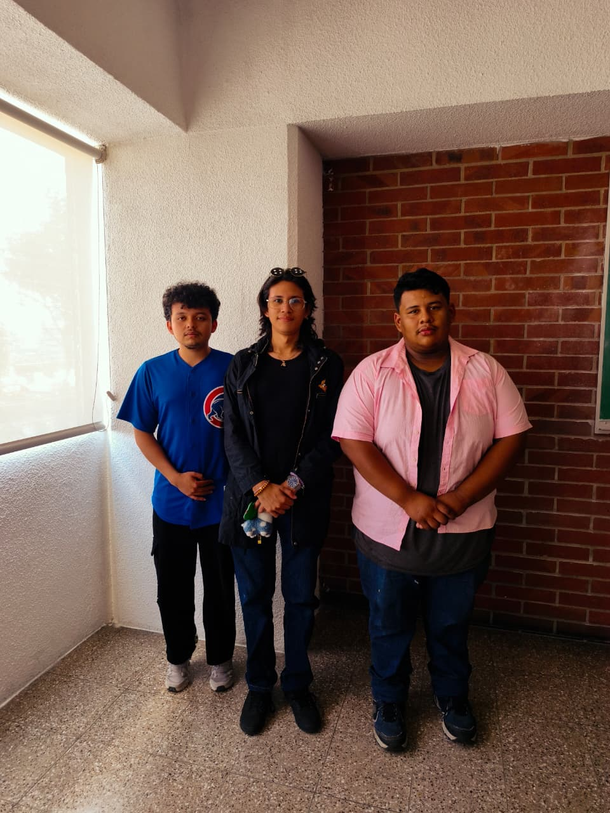

# Habitar Marte · Matemática IV

Proyecto académico de una colonia científica conceptual sobre un terreno sintético. Las seis fases conectan una función de elevación con decisiones de ubicación, una ruta espacial, integrales dobles y el volumen, la masa y el centro de masa de un depósito.

**[Abrir el modelo interactivo](https://drgdavis.github.io/Proyecto-Matematicas-4/)**

El enlace abre el explorador astronómico desde la **Vía Láctea**. Al acercarse se atraviesa un campo estelar y se llega al **Sistema Solar**. **Viajar a Marte** inicia el descenso a la base EVA03. **Ver entrega final** reúne el video, la identificación del equipo y los documentos.

En celular y tablet, **Controles** y **Datos del planeta** abren los paneles del sistema solar. En Marte, el modelo y su explicación se distribuyen según el ancho disponible y los botones Anterior/Siguiente permanecen accesibles. Las láminas se adaptan a lectura vertical; las expresiones largas pueden desplazarse horizontalmente.

El explorador solar ofrece acercamiento progresivo con rueda, gesto de pinza, botones y regulador de zoom. **Sol**, el planeta seleccionado, **Sistema** y **Galaxia** cambian el encuadre con transiciones suaves. En escritorio, **Mostrar paneles** recupera las herramientas. El tamaño de los cuerpos y las distancias se adaptan para la visualización; la vista galáctica usa una ilustración de contexto de [NASA GSFC / Conceptual Image Lab](https://svs.gsfc.nasa.gov/14930/).

La galaxia se dibuja con 120 000 puntos cuya densidad y color siguen la ilustración de referencia, con espesor del disco, núcleo y brillo difuso. Otros 60 000 forman el campo del tramo intermedio. Las posiciones individuales son ilustrativas y no corresponden a un catálogo astronómico. El modelo métrico de Marte conserva sus cálculos y dimensiones.

**[Ver la entrega y el video](https://drgdavis.github.io/Proyecto-Matematicas-4/materials/Entrega_EVA03.html)**

| Integrante | Carné |
|---|---|
| Carlos Haroldo Rodriguez Fuentes | 202574501 |
| Juan Carlos Boteo Granados | 202558502 |
| Davis Javier Rivera Aroche | 202558500 |



## Contenido

| Fase | Desarrollo |
|---|---|
| Terreno | Función diferenciable, coordenadas, dominio físico, curvas de nivel y trazas. |
| Cambio local | Derivadas parciales, plano tangente, normal, linealización, gradiente, direccionales y regla de la cadena. |
| Ubicación | Puntos críticos, Hessiano y optimización restringida con Lagrange. |
| Ruta | Curva espacial, derivadas, tangente, longitud de arco y curvatura. |
| Región R | Límites polares, integral doble, altura media y área real del relieve. |
| Depósito E | Semielipsoide, cambio de variables, jacobiano, integral triple, densidad, masa y centro de masa. |

El modelo contiene 22 escenas y permite explorar 53 temas. **Índice y respaldo** abre los documentos y el desarrollo de cada fase. Los estudios aplicados adicionales son complementarios.

## Documentos

- [Documentación final completa en ZIP](public/materials/Documentacion_Final_EVA03.zip).
- [Video del recorrido completo, formato MP4](public/materials/Video_Recorrido_EVA03.mp4).
- [Entrega con reproductor de video y fotografía del equipo](public/materials/Entrega_EVA03.html).
- [Informe técnico](public/materials/Informe_Tecnico_EVA03_Final.pdf).
- [Anexo matemático](public/materials/Anexo_Matematico_EVA03_Final.pdf).
- [Cinco estudios aplicados: datos, procedimientos y gráficas](public/materials/Cinco_Estudios_Aplicados_EVA03.pdf).
- [Plano integrado](public/materials/Plano_Integrado_EVA03_Final.pdf).
- [Presentación visual de 22 desarrollos](public/materials/Presentacion_EVA03_Defensa_Matematica_22_Escenas_Navegador.html).
- [Presentación en PDF](public/materials/Presentacion_EVA03_Defensa_Matematica_22_Escenas_Respaldo.pdf).

La presentación abre directamente en **22 desarrollos principales**, con fórmula y datos del caso visibles. Las flechas, PageDown o la barra espaciadora avanzan por procedimiento y conclusión. Las derivaciones centrales conservan pasos intermedios cuando son necesarios. **Consultar símbolos** abre una de las 22 fichas opcionales y permite volver al mismo desarrollo. Las fórmulas, los datos, los procedimientos y los resultados se componen desde LaTeX mediante KaTeX, con fuentes incrustadas para abrir el HTML sin conexión. **F** activa pantalla completa. El PDF de respaldo coloca primero los 22 desarrollos completos y después las 22 fichas de consulta.

## Resultados de referencia

| Medida | Resultado |
|---|---:|
| Pendiente de llegada B⁺ | 3.788 % |
| Longitud de la ruta principal | 226.205 m |
| Área real del terreno en R | 623.365 m² |
| Capacidad geométrica de E | 1344π ≈ 4 222.301 m³ |
| Masa con la densidad definida | 3 797 114.863 kg |
| Altura local del centro de masa | 2.970844 m |

B⁺ es el óptimo de pendiente sobre la circunferencia de comparación. La ruta principal y el ramal al taller se miden por separado. El volumen bajo el terreno se refiere al plano z=0. La masa y el centro se calculan con la función de densidad declarada en el anexo.

## Ejecutar el proyecto

Con Node.js 22 o posterior:

```powershell
git clone https://github.com/Drgdavis/Proyecto-Matematicas-4.git
cd Proyecto-Matematicas-4
npm ci
npm run dev
```

Abre `http://127.0.0.1:3000/`. Para usar una compilación estática:

```powershell
npm run build
node static-server.cjs
```

El modelo requiere WebGL 2 y aceleración gráfica. Puede comprobarse en [la prueba de WebGL 2](https://get.webgl.org/webgl2/). Los controladores y la configuración del navegador influyen en su disponibilidad.

Los datos académicos de portada se completan en `public/materials/Identificacion_Equipo.json`. Después se regeneran informe y anexo con `python scripts/build-final-materials.py`. Los datos sin confirmar permanecen señalados en las portadas.

## Código y verificación

- React y TypeScript: interfaz y navegación.
- Three.js y WebGL: terreno, edificios, rover, vectores y demostraciones 3D.
- HTML y CSS: presentación visual.
- KaTeX: fórmulas matemáticas.
- Python: generación de documentos finales.
- Node.js y Vite: desarrollo, compilación y verificadores.

`src/data/marsMath.ts` y `src/data/mathSolutions.ts` contienen los cálculos y procedimientos. `src/components/marsScene.ts` y `src/components/colonyCampus.ts` construyen la escena. Las fuentes editables del informe y el anexo están junto a sus PDF.

```powershell
npm run audit
```

Este comando comprueba tipos, resultados numéricos, aspectos geométricos, contenido de la entrega y compilación. La verificación combina comprobaciones automáticas del modelo con revisión visual del recorrido. GitHub Pages publica el build de `main` mediante el workflow del repositorio.

## Alcance y recursos

El relieve se define mediante una función sintética y los servicios se evalúan con las cargas indicadas en el modelo. Los resultados son reproducibles bajo esas condiciones. Una aplicación constructiva incorpora además estudios geotécnicos, estructurales y de operación de cada sistema.

Los créditos de la textura de roca están en [SOURCE.txt](public/materials/SOURCE.txt) y los de las texturas planetarias en [ATTRIBUTION.md](public/textures/ATTRIBUTION.md). El informe documenta las fuentes y los permisos de recursos que todavía requieren comprobación individual. La autoría del proyecto no transfiere derechos sobre los activos externos.

Las fuentes Inter y JetBrains Mono se incluyen localmente; sus orígenes y licencias están en [los créditos tipográficos](public/assets/fonts/CREDITOS.md). La interfaz mantiene su tipografía sin solicitar Google Fonts.
